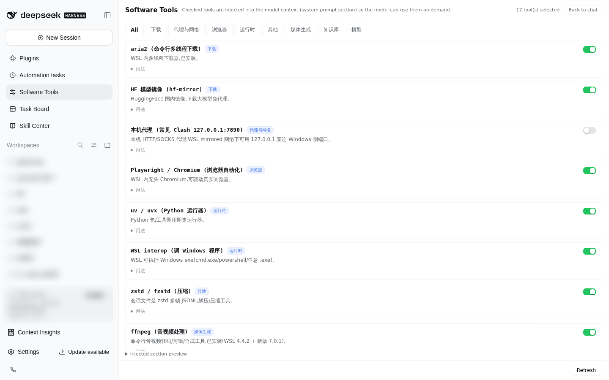

# dsh-software-tools

侧边栏 **软件工具** 面板(用 DSH 官方 Slot API 挂在面板导轨与中央面板位)—— 为 [DeepSeek Harness](https://github.com/deepseek-ai/deepseek-harness) Web 端维护一份"本机可用软件清单",勾选后注入模型系统提示,让每个会话都知道这台机器上有什么软件、怎么调用。

A sidebar **软件工具** panel for DeepSeek Harness Web: maintain a curated inventory of local software (WSL CLI tools + Windows apps via interop), check what you want the model to know, and the checked set is injected into the model's system prompt as a compact section — so every session knows what exists on this machine and how to call it.



*示意截图:工作区名与消费金额已模糊处理;界面细节可能落后于当前版本。*

## 它解决什么问题 / Problem

模型(如 deepseek-v4-flash)默认不知道你本机装了 IDM、ComfyUI、Obsidian、aria2…… 每次要用都得现解释路径和调用法。这个插件把"本机软件目录 + 调用法"变成**可勾选、持久化、自动注入系统提示**的一等公民,模型直接按 `usage` 字段的现成命令执行。

## 功能 / Features

| | 能力 | 说明 |
| --- | --- | --- |
| 🎚 | 面板导轨入口 | 按分类列出工具目录,勾选即生效(无需重启,下一次请求即可见) |
| 📥 | 内置 + 用户扩展合并 | 内置通用目录(aria2 / proxy / playwright / uvx / interop / zstd …);用户扩展 `catalog.json` 同 id 覆盖内置 |
| ✏️ | 面板内增删 | 面板底部 **+ 新增条目**(名称/说明/用法/分类)直接入库;用户条目行内「删除」并二次确认;内置条目只读不可删。删除会先备份 `catalog.json`、同步取消勾选;若该条覆盖了内置条目,删除后自动回落到内置版本 |
| 🧠 | 系统提示注入 | 勾选的工具以紧凑段落注入每个请求的 system prompt(`systemPrompt.section`,与 persona / plan-mode 同一机制) |
| 🛠 | 内置 skill | 随插件自带 `add-software-tool` 技能:模型学会把新装软件写进用户目录,免重编译/重启;条目按"使用说明"口径收窄,不写调优 |
| 🔒 | 回环 RPC | 面板↔宿主走 loopback 钉死的 RPC channel,读本地 JSON,不触碰网络 |

## 安装 / Install

```bash
dsh plugin --profile web add dsh-software-tools
```

> 提示:本机 pnpm 供应链策略拦截 `dsh plugin add` 时,手动拷贝:把包放进 `~/.dsh/profiles/web/node_modules/`,在 `~/.dsh/profiles/web/cordis.patch.yml` 追加:

```yaml
- insert:
    - id: dsh-software-tools
      name: dsh-software-tools
      config: {}
- insert:
    - id: software-tools-skill
      name: '@deepseek-ai/dsh-skill-filesystem'
      config:
        providerName: software-tools-skill
        includeDefaultRoots: false
        customSkillDirs:
          - !!js process.getBuiltinModule('node:path').join(process.getBuiltinModule('node:path').dirname(process.getBuiltinModule('node:module').createRequire(baseUrl).resolve('dsh-software-tools/package.json')), 'skills')
```

重启 `dsh web` 并硬刷新(Ctrl+Shift+R),侧边栏面板导轨出现 **软件工具** 一行(位于 Automation tasks 与 Task Board 之间)。

## 配置 / Configuration

全部可选,缺省零配置:

| 字段 | 默认 | 说明 |
| --- | --- | --- |
| `settingsDir` | `$DSH_HOME/software-tools` | 状态目录,存 `selection.json`(勾选)与 `catalog.json`(用户扩展目录) |

## 数据文件 / State files

| 文件 | 作用 |
| --- | --- |
| `<settingsDir>/selection.json` | `{"ids": ["aria2", ...]}` — 当前勾选 |
| `<settingsDir>/catalog.json` | `{"tools": [条目...]}` — 用户扩展目录;同 id 覆盖内置 |

### 条目字段上限 / Entry field limits

本表是**权威口径**(硬上限由宿主 `src/catalog.ts` 校验);内置技能与英文 README 都引用这里,不再各自重复数字。

| 字段 | 硬上限(超出即被宿主拒绝) | 写作目标 |
| --- | --- | --- |
| `id` | `[a-z0-9][a-z0-9._-]*`,≤64 字符,唯一 | 由名称自动生成;仅覆盖内置或显式 API 调用时才手写 |
| `name` | ≤200 字 | 显示名 + 用途括注,如 `ffmpeg (音视频处理)` |
| `category` | download / proxy / media / browser / knowledge / runtime / model / misc 之一 | 不确定选 `misc` |
| `desc` | ≤1000 字(只在面板显示,不注入) | 一句话、约 40–60 字:"是什么 / 何时用" |
| `usage` | ≤2000 字(**每轮请求都注入**) | ≤5 行、约 600 字:命令 + 调用前提 |

每次写 `catalog.json` / `selection.json` 都会先复制一份 `<文件名>.bak.<YYYYMMDD-HHMMSS>`(每个文件保留最近 20 份),再原子写入(临时文件 + rename),写到一半崩溃也不会截断目录。用户目录**只要有一处读不懂就绝不覆盖**:整个 JSON 解析失败报 `catalogError`;个别行缺 `id`/`name`/`desc`/`usage`/`category` 时,该行**原样保留在文件里**并计入 `catalogWarnings`,面板显示警告并停用新增/删除,直到修好;重复 id 按「后面覆盖前面」去重并给出警告。

> **条目只写"使用说明"**:写给"接下来要用这个工具的会话"——是什么、何时用、第一条命令敲什么。调优/运维/排障/沿革信息(显存门槛、KV/量化参数、实测吞吐、改端口步骤、迁移史…)不进条目,写进**该工具自己的文档**(README / 部署报告 / 指标速查),条目里最多留一句 `细节见 <路径>`。原因:条目每次请求都注入,长度即成本;调优所需上下文也远超几行。

### 护栏 / Guardrails(公开仓库)

本地状态**只**落 `$DSH_HOME/software-tools/`,绝不放进本仓库:

- `.gitignore` 已覆盖 `catalog.json*`、`selection.json*`(带时间戳的备份/副本一并覆盖)、`*.bak.*`、`.dsh/`、`config/`、`.env*`——就算把状态文件误放进仓库目录,也进不了索引。
- `pnpm run check:local-config` 扫描所有被跟踪的文本文件**与暂存区 diff**:命中本机路径(`/home/<用户>/`、`/mnt/<盘符>/`、盘符绝对路径)时打印 `文件:行号` 并 exit 1;本地状态/凭据文件按**前缀与模式**拦截(`catalog.json*`、`selection.json*`、`.env*`(除 `.env.example`)、文件名含 credential/secret、`*.pem`/`*.key`、`.dsh/` 或 `config/` 目录),`git add -f` 也拦得住。CI 在 typecheck 前执行。通用占位(`/path/to/...`、`C:\Tools\...`、`C:\Windows\...`、`C:\Program Files\...`)放行。
- 护栏脚本随包发布(`scripts/` 已进 files,装包后 `pnpm run check:local-config` 也能解析),但设计上在**源码仓库 / CI** 里跑(需要 git 索引)。
- 二进制(截图)由脚本点名跳过,人工脱敏——上方面板示意截图中的工作区名与消费金额已模糊处理。

#### 仓库历史 / Repository history

已发布的历史里,早期提交(例如 `f0a0780`、`f350915`)仍保留着本机路径与旧版未脱敏截图。这些历史对象**不做改写**:本次工作树清理与上面的护栏只保证**此后不再新增**此类内容。要彻底移除必须重写仓库(`git filter-repo` + 强推),该方案未被采用——因此请把公开历史视为包含过期的本地信息。

## 新增与删除条目 / Adding and removing entries

三条路径,刷新面板即生效(无需重编译、无需重启):

| 路径 | 适用 |
| --- | --- |
| **面板表单** —— 底部 **+ 新增条目**:名称/说明/用法/分类 | 已经知道怎么调用,最快 |
| **内置技能** —— 对模型说"把 XXX 加进软件工具" | 软件对你是新的,需要先调研(`add-software-tool` 技能会先只读探查本机,再写"只含使用说明"的条目) |
| **手工编辑** —— `catalog.json` | 脚本化 / 批量修改 |

`id` 由名称自动生成(`my tool` → `my-tool`,冲突时去重为 `my-tool-2`),面板不要求填写;每行以**小字展示 id**,新增成功提示里也会显示生成的 id。用户条目与内置条目同 id 即覆盖内置(面板标「覆盖内置」),删掉这条用户条目就回落到内置版本。

**面板表单只能新增用户条目**,不提供覆盖:与已有行 id 冲突会被拒绝(`id-conflict`)。要覆盖内置条目或替换已有用户条目,必须走显式 `id` + `overwrite: true` 的 `add` 调用(即技能 / JSON 路径),面板 UI 不暴露这个开关。

**删除**用条目行的「删除」按钮(行内二次确认)。只有 `catalog.json` 里的条目可删 —— 内置行只读(按钮禁用并提示)。删除会先备份文件、把该 id 从 `selection.json` 一并剔除(避免"删了却还在注入"),下一次请求起注入段落即更新。

## 工作原理 / How it works

- **宿主半** (`src/index.ts`):注册 `systemPrompt.section`(`software-tools`, order 200),每次组装按当前勾选渲染;注册 loopback RPC `/_dsh-software-tools`(`list` / `set` / `add` / `remove`);`list` 为每行附带 `origin`(`builtin`/`user`/`override`)与 `readonly`。
- **浏览器半** (`src/client/`):用官方 Slot API 贡献两个席位 —— `sidebar.panellist`(list,导轨行,`id` 即面板 id,`label` 是 thunk 所以标题随语言实时解析)与 `main`(keyed,面板体,由布局渲染在中央);两者都用 `ctx.slots.inject(key, …)` 等待 ui-layout / ui-sidebar 声明该席位。`tsdown` 构建为 `__ModuleLoader__` 惰性 CJS bundle(免额外依赖,React 由宿主外壳提供)。
- **技能** (`skills/add-software-tool/`):经 `dsh-skill-filesystem` 的 `customSkillDirs` 挂载,只看插件自带目录,不干扰默认技能根。

## License

[MIT](LICENSE)
